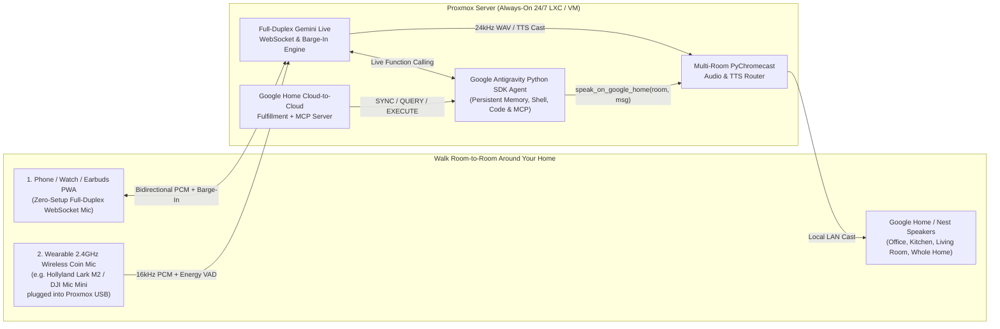

# Antigravity Google Home Bridge (`antigravity-google-home-bridge`)

**Always-On, Full-Duplex Google Antigravity Live Voice & Multi-Room Google Home Bridge for Proxmox and Home Servers.**

Run **Google Antigravity** 24/7 on your Proxmox server (or any Linux/macOS host) and walk freely from room to room while having a natural, interruptible ("barge-in") **Gemini Live** voice conversation that executes real Antigravity tasks and speaks back through your **Google Home / Nest speakers** in any room.

---

## Why This Exists (And How It Works Around Google Home's Hardware Limits)

Google Home and Nest speakers have closed firmware that locks their built-in microphones exclusivamente to one-shot `"Hey Google"` cloud intents—they cannot stream raw 24/7 full-duplex microphone audio to a local server.

**`antigravity-google-home-bridge` solves this with a Hybrid Full-Duplex Architecture:**



---

## Key Features

1. **Always-On 24/7 Proxmox Antigravity Agent (`google-antigravity` SDK):**
   * Runs continuously on your Proxmox LXC/VM without needing your laptop open.
   * Persists `conversation_id` across turns and restarts, with full access to your workspace, shell commands, homelab diagnostics, and custom tools.
   * Also supports connecting directly to a local Antigravity `ConversationService` Language Server if running on a workstation.
2. **Full-Duplex Gemini Live Voice Engine with Instant Barge-In (`/ws/live`):**
   * Streams bidirectional 16kHz/24kHz PCM audio to **Gemini Live** (`client.aio.live.connect`).
   * **Interrupt anytime:** Speak while Antigravity is talking and the Voice Activity Detector (VAD) immediately cancels playback and listens to your interruption.
3. **"Follow-Me" Multi-Room Google Home Cast Router (`pychromecast`):**
   * Auto-discovers every Google Home speaker and speaker group on your LAN (`Office`, `Kitchen`, `Living Room`, `Whole Home`).
   * Just say ***"Follow me to the kitchen"*** or ***"Switch audio to the office speaker"***—or tap a room pill in the PWA—and Antigravity immediately switches which Google Home speaker it talks through.
   * Supports **3 output routing modes**:
     * `both` (**Hybrid**): Instant zero-latency audio on your phone/earbuds + room cast on Google Home.
     * `cast` (**Google Home Speakers Only**): Ideal when wearing a clip-on wireless lapel mic around the house.
     * `direct` (**Direct Device / Bluetooth Only**): Lowest latency full-duplex audio directly to your phone, earbuds, or a Bluetooth-paired Google Home speaker.
4. **Direct Proxmox Hardware Wireless Mic Daemon (`agy-home-bridge hw-mic`):**
   * Want a **completely phone-free** experience with a coin-sized magnetic collar mic? Plug a 2.4GHz wireless lapel mic receiver (like a **Hollyland Lark M2**, **DJI Mic Mini**, or **AnkerWork M650**—up to 300m/1,000ft range) into a USB port on your Proxmox server.
   * The built-in hardware mic daemon streams your voice directly into the Live bridge with automatic VAD barge-in while playing Antigravity's voice out of your Google Home speakers.
5. **Official Google Home Cloud-to-Cloud Smart Home Fulfillment (`/api/google-home/fulfillment`):**
   * Implements `action.devices.SYNC`, `QUERY`, `EXECUTE`, and `DISCONNECT` ([Google Home Cloud-to-Cloud Intents](https://developers.home.google.com/cloud-to-cloud/primer/intents)) so you can also say *"Hey Google, turn on Antigravity Live"*, *"Hey Google, activate Antigravity in Kitchen"*, or *"Hey Google, activate Antigravity Status Report"*.
6. **Built-In Model Context Protocol (MCP) Server (`/mcp` & `agy-home-bridge mcp-stdio`):**
   * Exposes `speak_on_google_home`, `switch_active_google_home_room`, and `list_google_home_speakers` to any Antigravity IDE or CLI session on your network.

---

## Quickstart

### Option A: One-Command Proxmox LXC / Debian / Ubuntu Install (24/7 Service)

Inside a Debian or Ubuntu LXC container (or VM) on your Proxmox host (make sure the container is on your main LAN bridge `vmbr0` so mDNS / Chromecast discovery can reach your Google Home speakers):

```bash
git clone https://github.com/mavrikjc/antigravity-google-home-bridge.git
cd antigravity-google-home-bridge
sudo bash deploy/proxmox/install-lxc.sh
```

Then add your `GEMINI_API_KEY` (get one from [Google AI Studio](https://aistudio.google.com/app/api-keys)):

```bash
sudo nano /opt/antigravity-google-home-bridge/.env
sudo systemctl restart agy-home-bridge
```

### Option B: Docker Compose (with Host Networking for Google Home mDNS)

```bash
cp .env.example .env
# Edit .env and set GEMINI_API_KEY and HOST_LAN_IP (your server's LAN IP, e.g. 192.168.1.50)
docker compose up -d --build
```

### Option C: Local Python Development (macOS / Linux)

```bash
python3 -m venv .venv
source .venv/bin/activate
pip install -e ".[antigravity,hardware-mic,dev]"

cp .env.example .env
# Edit .env and set GEMINI_API_KEY
agy-home-bridge serve
```

Open **`http://<your-server-lan-ip>:8765`** on your phone, tablet, or desktop browser!

---

## CLI Commands

```bash
# 1. Start the Full-Duplex Live Voice & Google Home Bridge server
agy-home-bridge serve --host 0.0.0.0 --port 8765

# 2. Discover all Google Home speakers and speaker groups on your LAN
agy-home-bridge discover

# 3. Speak an announcement out loud on any Google Home room speaker
agy-home-bridge speak "Dinner is ready and all Proxmox backups succeeded." --room "Kitchen"

# 4. List USB wireless microphone receivers connected to Proxmox
agy-home-bridge hw-mic --list-devices

# 5. Start the Proxmox Hardware Wireless Mic Daemon (phone-free wearable coin mic mode)
agy-home-bridge hw-mic

# 6. Run as an MCP stdio server for Antigravity IDE / CLI
agy-home-bridge mcp-stdio
```

---

## Connecting Your Antigravity IDE / CLI via MCP

Add the bridge to your `~/.gemini/config/mcp_config.json` (either remotely over HTTP to your Proxmox server, or locally via stdio):

```json
{
  "mcpServers": {
    "google-home-voice-bridge": {
      "command": "agy-home-bridge",
      "args": ["mcp-stdio"]
    }
  }
}
```

Now any Antigravity agent can call:
* `speak_on_google_home(message="Build finished!", room="Office")`
* `switch_active_google_home_room(room="Kitchen")`
* `list_google_home_speakers(refresh=true)`

---

## Running Tests

```bash
pytest -v
```

---

## License

MIT © John-Isaac Clark
